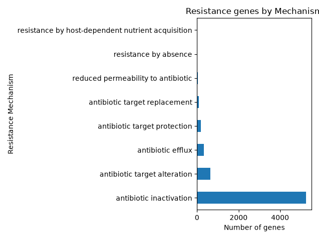
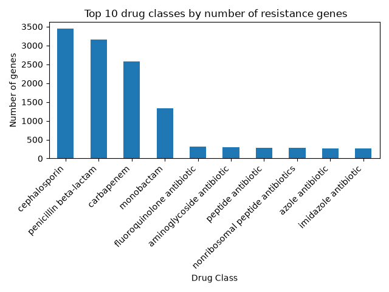

# CARD Antibiotic Resistance Gene Explorer

Exploring which drug classes and resistance mechanisms are most common among known antibiotic resistance genes in the CARD database.

## Motivation
My systematic review on antibiotic self-medication looked at how antibiotics are misused. This project looks at the genetic side of the same problem: which resistance genes are catalogued, and which antibiotics they affect.

## Question
Which drug classes and resistance mechanisms are most common among the resistance gene entries in CARD?

## Data
- Source: the Comprehensive Antibiotic Resistance Database (CARD), https://card.mcmaster.ca
- Version: 4.0.2 (August 2026)
- File used: `aro_index.tsv` (6,463 entries, 12 columns)
- The data file is not included in this repo. Download the CARD data from the link above and place `aro_index.tsv` in the same folder as the script.

## Method
1. Loaded the table with pandas.
2. Some genes list several mechanisms or drug classes in one cell, separated by semicolons. I split these and gave each its own row.
3. Counted entries per mechanism and per drug class.
4. Plotted the results with matplotlib (top 10 for drug classes).

## Results

### Resistance mechanisms

Antibiotic inactivation is by far the most common mechanism, at over 5,000 entries. Target alteration (about 600) and efflux (about 300) follow.

### Drug classes

Cephalosporin, penicillin beta-lactam, carbapenem and monobactam lead, each with over 1,000 entries. The remaining classes in the top 10 have roughly 250 to 300 each.

## Interpretation
The two charts agree. Inactivation is the top mechanism, and the top drug classes are all beta-lactams, which are the drugs broken down by beta-lactamase enzymes. Azole and imidazole classes also appear because recent CARD releases added many antifungal terms.

## Limitations
- A gene that lists several classes or mechanisms is counted under each, so the charts show how many entries are linked to each category, not unique genes.
- CARD reflects what has been curated by researchers, not how common a gene is in patients. Well-studied families such as beta-lactamases are likely over-represented.

## How to run
1. Install the libraries: `pip install pandas matplotlib`
2. Place `aro_index.tsv` in the same folder as `explore_card.py`
3. Run `python explore_card.py`

## Next steps
Compare these patterns with real resistance surveillance data (my next project).
